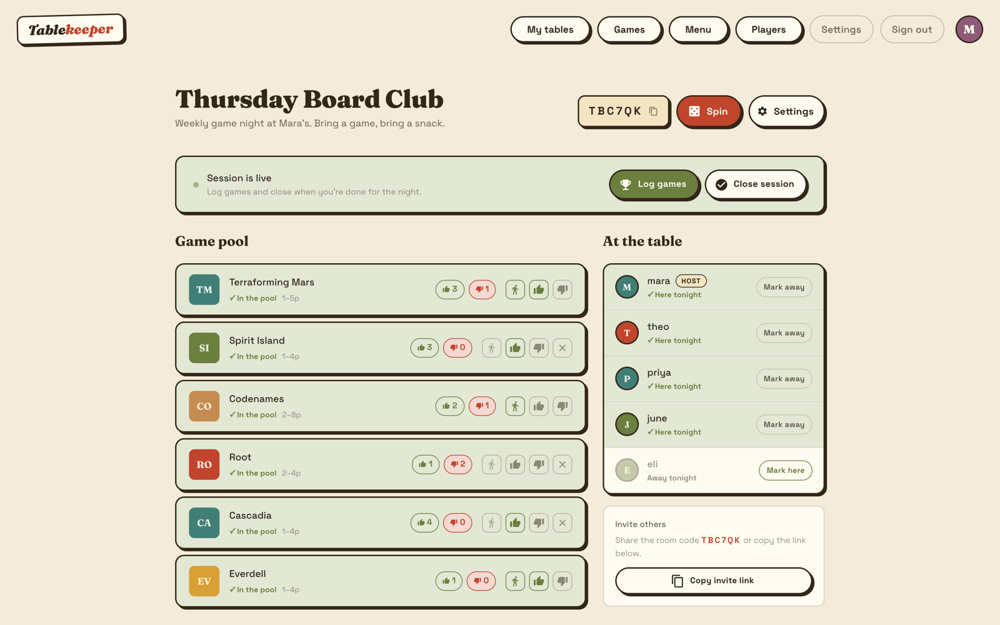
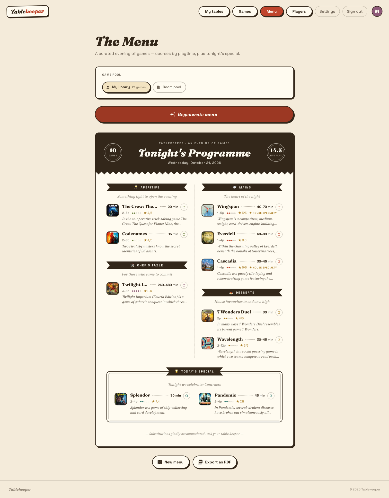
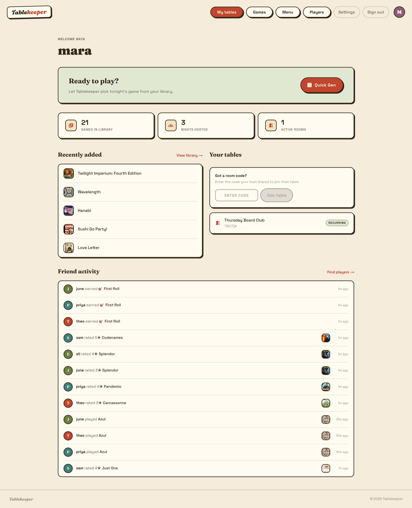
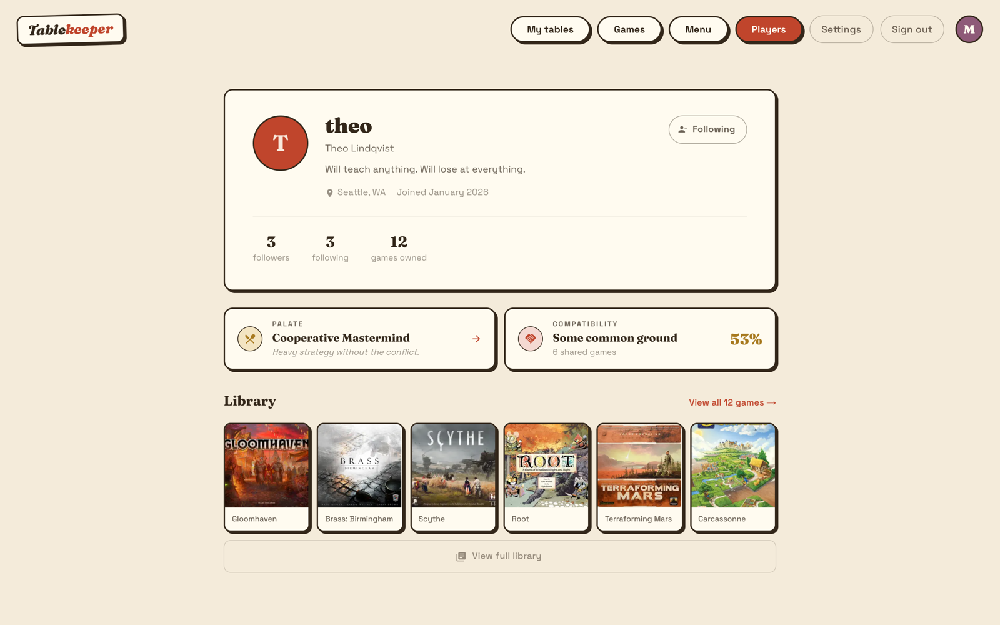
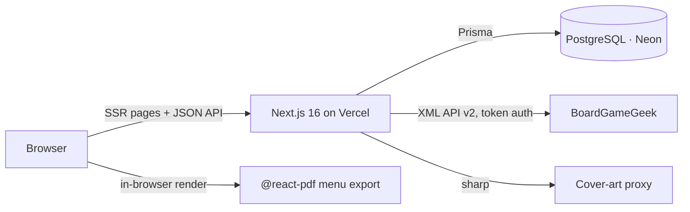
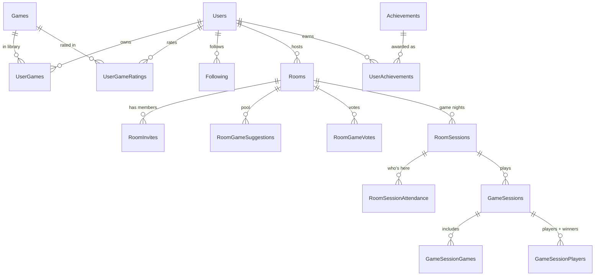

<div align="center">

# Tablekeeper

### Board game night, sorted.

Your library, your table, and a menu for the whole evening.

[](https://tablekeeper.vercel.app)


[](https://tablekeeper.vercel.app)

</div>

Tablekeeper is a web app for people who own too many board games and still can't decide what to
play. You keep your collection in one place, and Tablekeeper helps a group of friends settle on a
game in seconds. It can also lay out a whole evening as a printable "menu", with courses sorted by
playtime.

## 📸 Screenshots

<table>
  <tr>
    <td width="50%"></td>
    <td width="50%"></td>
  </tr>
  <tr>
    <td align="center"><b>The Menu</b>: a date-seeded evening, exportable as a one-page PDF</td>
    <td align="center"><b>Dashboard</b>: your tables, recent additions, and what friends are playing</td>
  </tr>
  <tr>
    <td colspan="2"></td>
  </tr>
  <tr>
    <td colspan="2" align="center"><b>Player profiles</b>: taste archetype, compatibility score, and library at a glance</td>
  </tr>
</table>

<sub>Screenshots use fictional demo players. Game data and art come from BoardGameGeek.</sub>

## ✨ What it does

|     | Feature                   | Details                                                                                                                                                                                              |
| --- | ------------------------- | ---------------------------------------------------------------------------------------------------------------------------------------------------------------------------------------------------- |
| 📚  | **Game library**          | Search BoardGameGeek's catalogue or import a whole BGG collection. Box art, player counts, playtime, complexity, mechanics and designers are filled in automatically.                                |
| 🎲  | **Weighted randomizer**   | Pick a game in one tap. Favourites and highly rated games get better odds, and you can veto a pick and re-roll.                                                                                      |
| 🍽️  | **Game-night menu**       | A date-seeded "tasting menu" of 12 games or fewer: Apéritifs, Mains, Chef's Table and Desserts by playtime, plus a rotating themed _Today's Special_. Exports to a one-page PDF.                     |
| 🚪  | **Rooms**                 | Share a short room code. Members suggest games from their libraries and vote, and the room page refreshes live. Rooms can be public, link-only, or invite-only with join requests the host approves. |
| 📝  | **Sessions & attendance** | Open a game night, mark who's at the table, and log games played with winners. Recurring groups keep their full play history.                                                                        |
| 🧭  | **Taste profiles**        | Each player gets an archetype built from their library and ratings: complexity tier, attention span, player-count sweet spot, favourite themes, and the ones to avoid.                               |
| 🤝  | **Compatibility**         | Compare yourself with any player. You get a 0–100 score from library overlap, taste similarity, complexity and playtime fit, and how your ratings line up, plus games you'd both enjoy.              |
| 👥  | **Social**                | Follow friends and see their recent ratings, plays and achievements in a dashboard activity feed.                                                                                                    |
| 🏆  | **Achievements**          | 60+ achievements across library size, geography, mechanics, complexity, ratings, social play and streaks.                                                                                            |

## 🏗️ System architecture

Tablekeeper is a single Next.js app on Vercel. Pages are server-rendered with `getServerSideProps`,
and API routes under `pages/api/` hold all the business logic. Postgres (Neon) is reached through
Prisma. Game metadata comes from the BoardGameGeek XML API through an authenticated server-side
proxy, so the API token never reaches the browser.



**Data flow for a room:** members join with a code, then the room page polls a slimmed-down endpoint
every five seconds for suggestions, votes and attendance. Writes such as voting, logging a game or
toggling attendance go through validated API routes. Those routes check membership and host
permissions, and they wrap multi-row writes in a single Prisma transaction. Achievement checks run
after the write and never block the request.

## 📁 Project structure

```
pages/                 # Next.js Pages Router
├── api/
│   ├── auth/          # NextAuth credentials login + rate-limited registration
│   ├── bgg/           # BoardGameGeek search, detail, collection import, enrichment
│   ├── games/         # library, ratings, wishlist, favourites, cover-art proxy
│   ├── rooms/[code]/  # room state, members, voting pool, session open/log/close
│   └── user/          # profiles, follows, compatibility
├── dashboard/         # home feed: friend activity, rooms, quick actions
├── games/             # catalogue + per-game detail with play history
├── menu/              # game-night menu generator
├── players/           # profiles, libraries, followers, settings
└── rooms/             # create, join, and run a room
src/
├── components/        # UI grouped by domain: games, rooms, players, menu, pdf, modals, ui
├── data/              # Prisma singleton + query helpers
├── lib/
│   ├── bgg/           # shared BGG client (batched fetches, timeouts)
│   └── menu/          # seeded menu engine, layout geometry, tasting-note formatting
├── services/          # achievements, taste profile, compatibility, friend activity
└── styles/            # MUI theme and design tokens
prisma/                # schema, migrations, achievement seed
scripts/               # BGG backfill + one-page PDF verification harness
```

## 🗃️ Data model

`Games` rows are shared across users and keyed by BoardGameGeek ID. A user's collection, ratings and
notes live in join tables, so one metadata backfill improves every library at once.



## 🧰 Tech stack

| Layer     | Choice                                      | Why                                                                              |
| --------- | ------------------------------------------- | -------------------------------------------------------------------------------- |
| Framework | Next.js 16 (Pages Router), React 19         | SSR and API routes in one deployable, with simple per-page data loading          |
| Language  | TypeScript (strict)                         | One set of types from the Prisma schema through API responses to components      |
| UI        | MUI 7 + Emotion                             | Accessible primitives, fully restyled with a custom "Café Press" theme           |
| Database  | PostgreSQL (Neon) + Prisma 6                | Relational data with many join tables. `citext` gives case-insensitive usernames |
| Auth      | NextAuth (credentials + JWT), bcrypt        | Username/password accounts with no third-party sign-in required                  |
| Game data | BoardGameGeek XML API v2, `fast-xml-parser` | The canonical board game catalogue                                               |
| PDF       | `@react-pdf/renderer`                       | Printable menus rendered in the browser from the same data as the web view       |
| Images    | `sharp`                                     | Proxies and re-encodes BGG cover art so it can be embedded in PDFs               |
| Forms     | Formik + Yup                                | Declarative validation for registration, rooms and settings                      |
| Hosting   | Vercel                                      | Preview deployments per branch, zero-config Next.js                              |

## 🚀 Local development

**Requirements:** Node 20+, pnpm, and a PostgreSQL database.

```bash
pnpm install                 # also runs `prisma generate`
cp .env.example .env         # then fill in the values below
npx prisma migrate dev       # create the schema
npx prisma db seed           # load the achievement catalogue
pnpm dev                     # http://localhost:3000
```

**Environment variables**

| Variable                   | Required | Purpose                                           |
| -------------------------- | -------- | ------------------------------------------------- |
| `POSTGRES_PRISMA_URL`      | ✅       | Pooled Postgres connection string                 |
| `POSTGRES_URL_NON_POOLING` | ✅       | Direct connection string, used for migrations     |
| `NEXTAUTH_SECRET`          | ✅       | Signs session JWTs                                |
| `NEXTAUTH_URL`             | ✅       | Base URL of the app, e.g. `http://localhost:3000` |
| `BGG_API_TOKEN`            | ✅       | BoardGameGeek XML API token                       |

**Scripts**

| Command             | What it does                                                                                     |
| ------------------- | ------------------------------------------------------------------------------------------------ |
| `pnpm dev`          | Start the dev server                                                                             |
| `pnpm build`        | Production build                                                                                 |
| `pnpm test`         | ESLint, Prettier check and `tsc --noEmit`                                                        |
| `pnpm format`       | Format with Prettier                                                                             |
| `pnpm backfill:bgg` | Idempotent backfill of mechanics, categories and designers from BGG (rate-limited, with backoff) |

## ⚖️ Trade-offs

- **Polling instead of WebSockets.** Rooms refresh every five seconds from a trimmed payload. Groups
  are small and a game night lasts hours, so polling is easy to run on serverless hosting with no
  extra infrastructure.
- **In-memory rate limiting.** Login and registration use a per-process sliding window. That is
  enough at this scale. If the app ever runs on more than a few instances, it needs a shared store
  such as Redis.
- **The PDF fits one page by construction.** The menu layout has two density tiers, picked by game
  count, instead of being measured after rendering. A script in `scripts/pdfverify/` renders every
  menu size and checks that each one comes out as exactly one Letter page.
- **Deterministic "random" menus.** Menus are seeded from the date and the user, so the same evening
  always shows the same menu, even after a refresh or on another device. "New menu" and per-slot
  rerolls bump the seed.
- **Pages Router over App Router.** The app predates a stable App Router. `getServerSideProps` keeps
  data loading explicit and easy to follow.

## 🔭 Roadmap

- "Who can teach this?": flag games you can teach, shown on room suggestions
- Scheduled game nights with dates, times and notifications
- Play statistics and an achievements showcase on profiles
- Password reset
- An automated test suite in CI

## 📄 License

All rights reserved. © Daniel Mendez Perdomo.

### Third-party data

Game data and images are provided by [BoardGameGeek](https://boardgamegeek.com) through the BGG XML
API. Tablekeeper is not affiliated with BoardGameGeek.
